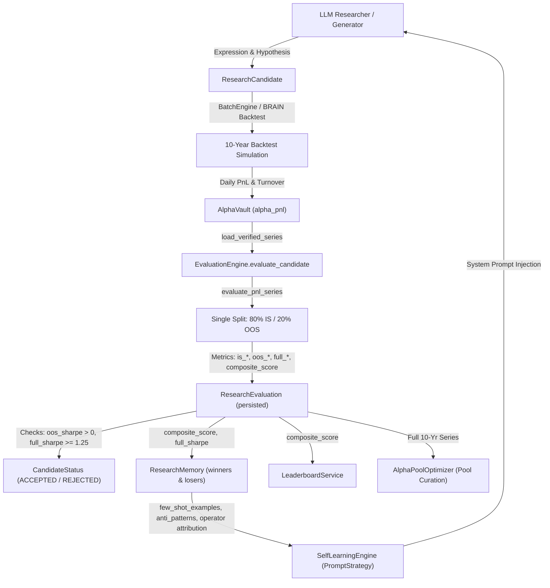

# P0-03 Audit Report: Proper IS / Validation / Final Holdout Separation

**Status: AUDIT COMPLETE — AWAITING APPROVAL**

---

## 1. Executive Summary

An exhaustive audit of the `alpha-harness` quantitative research pipeline was conducted to assess whether the system enforces proper separation between **In-Sample (IS)**, **Validation**, and **Final Holdout** data.

### Primary Audit Findings:
1. **Total Absence of a 3-Way Split**:
   The system currently operates on a **2-way split** (`is_*` vs `oos_*`). There is no concept of a separate **Validation** partition versus a **Final Holdout** partition anywhere in the database schema, data models, evaluation scorecard, or APIs.
2. **Immediate and Unrestricted Holdout Exposure**:
   The out-of-sample data (the final 20% of the 10-year backtest, typically 2 years) is evaluated at the exact same moment as the in-sample data. Full-period statistics (all 10 years) and OOS metrics are immediately calculated, persisted, and exposed.
3. **Severe Information Leakage into Prompt Evolution and Alpha Generation**:
   The closed-loop self-learning engine ([`SelfLearningEngine.execute_learning_cycle`](file:///C:/Users/LENOVO/Desktop/alpha-harness/backend/src/alpha_harness/learning/loop.py#L67-L230)) and research memory ([`ResearchMemory.get_session_performance_split`](file:///C:/Users/LENOVO/Desktop/alpha-harness/backend/src/alpha_harness/learning/memory.py#L80-L130)) rank candidates using [`ResearchEvaluation.composite_score`](file:///C:/Users/LENOVO/Desktop/alpha-harness/backend/src/alpha_harness/db/models.py#L939-L941) and [`ResearchEvaluation.full_sharpe`](file:///C:/Users/LENOVO/Desktop/alpha-harness/backend/src/alpha_harness/db/models.py#L930).
   - Top winners selected by full-period and OOS performance are injected as `few_shot_examples` directly into subsequent LLM system prompts.
   - Low performers filtered by OOS `sharpe_decay` are injected as `anti_patterns`.
   - Operator efficacy statistics (`compute_operator_stats`) aggregate 10-year `full_sharpe` to decide `preferred_operators` and `avoid_operators`.
   - **Result**: Future generation batches directly snoop on the holdout period.
4. **Candidate Selection & Pool Curation Leakage**:
   - Status promotion to `ACCEPTED` requires passing BRAIN checks that mandate positive OOS Sharpe and full 10-year Sharpe $\ge 1.25$.
   - The Leaderboard sorts and displays candidates by `composite_score` (which includes full-period after-cost Sharpe and OOS Sharpe decay).
   - Portfolio pool curation ([`AlphaPoolOptimizer.curate_pool`](file:///C:/Users/LENOVO/Desktop/alpha-harness/backend/src/alpha_harness/portfolio/pool.py#L175-L250)) uses the entire 10-year daily series to compute correlation matrices and portfolio metrics.
5. **No Final Holdout Reservation Policy**:
   There is no mechanism to seal holdout data, no distinction between development evaluations and final assessments, and no protection against continuous re-tuning against the entire time series.

---

## 2. Existing Architecture and Actual Data Flow



### Step-by-Step Data Flow Analysis:
1. **Simulation**: WorldQuant BRAIN executes a backtest over the full available history (typically 10 years, ~2,520 trading days).
2. **Ingestion & Vault**: [`AlphaVault.load_verified_series(alpha_id)`](file:///C:/Users/LENOVO/Desktop/alpha-harness/backend/src/alpha_harness/vault/store.py#L772-L803) returns all verified `(dates, pnl_series, turnover_series)`.
3. **Evaluation ([`metrics.py`](file:///C:/Users/LENOVO/Desktop/alpha-harness/backend/src/alpha_harness/evaluation/metrics.py#L109-L215))**:
   - If `split_date` is not supplied, it defaults to `dates[int(len(dates) * 0.80)]`.
   - `is_mask = d_arr < cut` (first 80%)
   - `oos_mask = d_arr >= cut` (last 20%)
   - Metrics are computed for `is_*`, `oos_*`, and `full_*` (100% of dates).
   - `composite_score = 0.40 * ac_sharpe + 0.30 * full_fitness + 0.20 * (1.0 - clamped_decay) - 0.10 * turnover`.
   - `checks` evaluate `full_sharpe >= 1.25`, `full_fitness >= 1.00`, and `oos_sharpe > 0.0`.
4. **Learning Feedback ([`learning/memory.py`](file:///C:/Users/LENOVO/Desktop/alpha-harness/backend/src/alpha_harness/learning/memory.py) & [`learning/loop.py`](file:///C:/Users/LENOVO/Desktop/alpha-harness/backend/src/alpha_harness/learning/loop.py))**:
   - `winners` are candidates with highest `composite_score`.
   - `losers` are candidates with `sharpe < 0.8` or `sharpe_decay > 0.4`.
   - Top 3 winners become few-shot examples in `PromptStrategy`.
   - Bottom losers become anti-patterns.
   - The new `PromptStrategy` is set as `is_active=True`, immediately informing subsequent candidate generation rounds.

---

## 3. IS / Validation / Final Holdout Audit Matrix

| Audit Dimension | Requirement | Current Implementation | Status |
|:---|:---|:---|:---|
| **Split Structure** | Explicit 3-way partition (IS, Validation, Final Holdout) | Only 2-way split (`is_*` vs `oos_*`). No validation partition. | ❌ Defect |
| **Boundary Determinism** | Reproducible, deterministic date cutoffs | Single `split_date` (80% default or explicit). Deterministic for 2 splits, absent for 3 splits. | ⚠️ Partial |
| **Temporal Ordering** | Chronological ordering $T_{\text{IS}} < T_{\text{Val}} < T_{\text{Holdout}}$ | Dates ordered ascending, but entire period evaluated simultaneously. | ⚠️ Partial |
| **Generation Isolation** | LLM generation uninformed by Holdout | Prompt reflection loop feeds top `composite_score` and `sharpe_decay` winners/losers into prompts. | ❌ Defect |
| **Strategy Selection** | Selection/tuning uses Validation only | Leaderboard and selection use full-period Sharpe and OOS Sharpe decay. | ❌ Defect |
| **Final Assessment** | Holdout reserved until selection complete | Holdout (current OOS) computed and exposed immediately during draft evaluation. | ❌ Defect |
| **Repeated Queries** | Gated/restricted query access to Holdout | Any user or automated loop can query full metrics repeatedly via API. | ❌ Defect |
| **Transaction Costs** | Consistent fee deduction across splits | `cost_bps` applied to full period (`after_cost_sharpe`), but not individually broken down per split. | ⚠️ Partial |
| **Persistence** | Effective boundaries persisted with record | Only single `split_date` persisted on `ResearchEvaluation`. | ⚠️ Partial |

---

## 4. Confirmed Defects with Code Evidence

### Finding P0-03-A: Lack of 3-Way Partitioning (IS / Validation / Holdout)
- **Severity**: Critical
- **Status**: Confirmed defect
- **Location**: [`alpha_harness/evaluation/metrics.py:109-154`](file:///C:/Users/LENOVO/Desktop/alpha-harness/backend/src/alpha_harness/evaluation/metrics.py#L109-L154), [`alpha_harness/db/models.py:914-955`](file:///C:/Users/LENOVO/Desktop/alpha-harness/backend/src/alpha_harness/db/models.py#L914-L955)
- **Code Behavior**:
  ```python
  # metrics.py lines 141-153
  if split_date is None:
      split_idx = int(len(dates) * 0.80)
      split_date = dates[split_idx]

  scorecard.split_date = split_date
  ...
  is_mask = d_arr < cut
  oos_mask = d_arr >= cut
  ```
- **Scientific Impact**: Merging Validation and Final Holdout into a single "OOS" bucket prevents separating hyperparameter/strategy tuning from unbiased out-of-sample evaluation. Any tuning performed against "OOS" invalidates it as a true holdout.

### Finding P0-03-B: Holdout Information Leakage into Closed-Loop Prompt Evolution
- **Severity**: Critical
- **Status**: Confirmed defect
- **Location**: [`alpha_harness/learning/memory.py:112-127`](file:///C:/Users/LENOVO/Desktop/alpha-harness/backend/src/alpha_harness/learning/memory.py#L112-L127), [`alpha_harness/learning/loop.py:98-107, 182-196`](file:///C:/Users/LENOVO/Desktop/alpha-harness/backend/src/alpha_harness/learning/loop.py#L98-L107)
- **Code Behavior**:
  ```python
  # memory.py lines 112-127
  "sharpe": ev.full_sharpe or 0.0,
  "after_cost_sharpe": ev.after_cost_sharpe or 0.0,
  "sharpe_decay": ev.sharpe_decay or 0.0,
  "composite_score": ev.composite_score or 0.0,
  ...
  records.sort(key=lambda r: float(r["composite_score"]), reverse=True)
  winners = records[:cutoff_top]
  losers = [r for r in records[cutoff_top:] if r["sharpe"] < 0.8 or r["sharpe_decay"] > 0.4]
  ```
  And in `loop.py`:
  ```python
  # loop.py lines 182-188
  few_shot_examples = [
      {"hypothesis": w["hypothesis"], "expression": w["expression"], "sharpe": w["sharpe"]}
      for w in winners[:3]
  ]
  ```
- **Scientific Impact**: The LLM in generation $G+1$ receives expressions and hypotheses that were explicitly filtered and rewarded based on their performance in the holdout period. This is textbook data snooping.

### Finding P0-03-C: Immediate Candidate Acceptance Gating on Holdout Metrics
- **Severity**: High
- **Status**: Confirmed defect
- **Location**: [`alpha_harness/evaluation/metrics.py:202-214, 326-330`](file:///C:/Users/LENOVO/Desktop/alpha-harness/backend/src/alpha_harness/evaluation/metrics.py#L202-L214)
- **Code Behavior**:
  ```python
  # metrics.py lines 202-208
  checks["sharpe_gte_1_25"] = f_sharpe >= DEFAULT_MIN_SHARPE # 10-year full Sharpe
  checks["oos_sharpe_positive"] = (scorecard.oos_sharpe or 0.0) > 0.0 # OOS Sharpe
  ...
  new_status = (
      CandidateStatus.ACCEPTED
      if scorecard.is_submission_grade
      else ...
  )
  ```
- **Scientific Impact**: Candidates are accepted or rejected during development directly on holdout metrics, eliminating the holdout's role as an untouched final validation gate.

### Finding P0-03-D: Full-Period Exposure in Leaderboard and Pool Selection
- **Severity**: High
- **Status**: Confirmed defect
- **Location**: [`alpha_harness/leaderboard/service.py:131-153`](file:///C:/Users/LENOVO/Desktop/alpha-harness/backend/src/alpha_harness/leaderboard/service.py#L131-L153), [`alpha_harness/portfolio/pool.py:185, 215-224`](file:///C:/Users/LENOVO/Desktop/alpha-harness/backend/src/alpha_harness/portfolio/pool.py#L185)
- **Code Behavior**:
  - The leaderboard orders alphas by `composite_score` (calculated over all 10 years).
  - Pool optimization computes correlation matrices using the full 10-year daily series (`pnl_series_map`), allowing holdout correlation to influence portfolio construction.

---

## 5. Existing Compliant Behavior to Preserve

1. **Deterministic Date Sorting and Alignment**:
   [`AlphaVault.load_verified_series`](file:///C:/Users/LENOVO/Desktop/alpha-harness/backend/src/alpha_harness/vault/store.py#L772-L803) enforces `ORDER BY date`, non-null verification, and a 20-observation minimum threshold.
2. **Transaction Cost Calculation**:
   [`after_cost(pnl, turnover, cost_bps)`](file:///C:/Users/LENOVO/Desktop/alpha-harness/backend/src/alpha_harness/evaluation/metrics.py) accurately deducts linear turnover costs.
3. **Statistical Integrity**:
   Annualized Sharpe, fitness, turnover, margin, and drawdown calculations via `stats()` function are mathematically consistent and robust against division by zero.
4. **Database Non-Destructive Migrations**:
   Additive migration patterns established in P0-01 and P0-02 preserve legacy records safely.
5. **Session Isolation**:
   Evaluation queries and API endpoints are cleanly partitioned by `session_id`.

---

## 6. Leakage Risks and Unresolved Questions

1. **WorldQuant BRAIN Platform Boundary**:
   - WorldQuant BRAIN backtest simulates over a fixed 10-year period. The local harness cannot alter BRAIN's server-side simulation window.
   - *Resolution*: The 3-way split must be enforced locally on the daily returns series ingested from BRAIN into `AlphaVault`.
2. **Temporal Split Ratio Standards**:
   - For a 10-year historical backtest (e.g., 2,520 trading days):
     - **In-Sample (IS)**: First 60% (~6 years, e.g. Days 0 to 1,511). Used for hypothesis formulation and initial validation.
     - **Validation**: Middle 20% (~2 years, e.g. Days 1,512 to 2,015). Used for model selection, tournament ranking, and prompt evolution.
     - **Final Holdout**: Final 20% (~2 years, e.g. Days 2,016 to 2,519). Sealed until explicit final candidate graduation.
3. **Sealed Holdout Gating**:
   - How should holdout evaluation be invoked?
   - Holdout evaluation must be an explicit, one-way action (e.g., `POST /candidates/{id}/evaluate-holdout` or `CandidateStatus.GRADUATED`), not run automatically during exploratory generation batches.

---

## 7. Proposed P0-03 Implementation Plan

### Phase 1: Database Schema Evolution (Additive & Non-Destructive)
Extend [`ResearchEvaluation`](file:///C:/Users/LENOVO/Desktop/alpha-harness/backend/src/alpha_harness/db/models.py#L895) with dedicated validation and holdout metrics:
- `val_sharpe`, `val_fitness`, `val_turnover`, `val_returns`, `val_drawdown`
- `holdout_sharpe`, `holdout_fitness`, `holdout_turnover`, `holdout_returns`, `holdout_drawdown`
- `is_end_date` (Date), `val_end_date` (Date)
- `holdout_evaluated_at` (UtcDateTime, nullable)
- Update [`Database.migrate()`](file:///C:/Users/LENOVO/Desktop/alpha-harness/backend/src/alpha_harness/db/sqlite.py) with additive `ALTER TABLE` statements.

### Phase 2: 3-Way Partitioning in `metrics.py`
1. Update [`EvaluationScorecard`](file:///C:/Users/LENOVO/Desktop/alpha-harness/backend/src/alpha_harness/evaluation/metrics.py#L50-L86):
   Add fields for Validation and Holdout statistics.
2. Refactor [`evaluate_pnl_series`](file:///C:/Users/LENOVO/Desktop/alpha-harness/backend/src/alpha_harness/evaluation/metrics.py#L109-L215):
   - Accept `is_end_date` and `val_end_date` (or calculate defaults: 60% IS, 20% Validation, 20% Holdout).
   - In standard mode (`evaluate_holdout=False`):
     - Compute `is_*` metrics on $t < \text{is\_end\_date}$.
     - Compute `val_*` metrics on $\text{is\_end\_date} \le t < \text{val\_end\_date}$.
     - Compute `dev_*` (combined IS + Validation) metrics.
     - **Do NOT calculate holdout metrics**. Holdout fields remain `None`.
     - `composite_score` is computed strictly using **Validation and IS metrics** (e.g., Validation After-Cost Sharpe and Validation Fitness), **never holdout data**.
   - In final holdout mode (`evaluate_holdout=True`):
     - Compute `holdout_*` metrics on $t \ge \text{val\_end\_date}$.

### Phase 3: Sanitize Learning Loop & Selection
1. **[`ResearchMemory`](file:///C:/Users/LENOVO/Desktop/alpha-harness/backend/src/alpha_harness/learning/memory.py)**:
   - Rank candidates and pick winners/losers using **Validation Sharpe / Validation Composite Score**.
   - Strip any access to holdout metrics from `get_session_performance_split` and `compute_operator_stats`.
2. **[`SelfLearningEngine`](file:///C:/Users/LENOVO/Desktop/alpha-harness/backend/src/alpha_harness/learning/loop.py)**:
   - In `few_shot_examples`, inject Validation Sharpe (`val_sharpe`).
   - Operator attribution uses Validation metrics.
3. **Candidate Status Lifecycle**:
   - `EVALUATED`: Evaluated on IS and Validation.
   - `ACCEPTED`: Passes Validation benchmarks.
   - `GRADUATED`: Explicit final step that reveals Holdout performance.

### Phase 4: API & Leaderboard Updates
1. Update `LeaderboardService` to rank by `val_composite_score` during active research sessions.
2. Update `/sessions/{session_id}/evaluations` and `/leaderboards/alphas` to hide unsealed holdout metrics until graduated.
3. Expose dedicated endpoint `POST /candidates/{id}/graduate` to unlock final holdout assessment.

---

## 8. Regression-Test Plan and Acceptance Criteria

### Test Cases in `tests/test_p0_03_splits.py`:
1. `test_three_way_split_deterministic_boundaries`:
   Verifies that dates are split cleanly into $T_{\text{IS}} < T_{\text{Val}} < T_{\text{Holdout}}$ without overlap or missing days.
2. `test_candidate_evaluation_masks_holdout_by_default`:
   Asserts that standard evaluation populates `is_*` and `val_*` metrics while `holdout_*` fields remain strictly `None`.
3. `test_composite_score_independent_of_holdout`:
   Modifying holdout PnL does not alter the candidate's `composite_score` or validation ranking.
4. `test_learning_loop_consumes_only_validation_metrics`:
   Verifies that `SelfLearningEngine` few-shot examples and operator statistics reflect only Validation period performance.
5. `test_leaderboard_ranks_on_validation_score`:
   Ensures leaderboard order is determined strictly without holdout knowledge.
6. `test_holdout_graduation_unseals_holdout_atomically`:
   Verifies that explicit graduation computes and records holdout metrics without altering historical IS/Val records.
7. `test_legacy_migration_compatibility`:
   Existing P0-01 and P0-02 records with 2-way splits remain readable and operational.

### Acceptance Criteria:
- [ ] Complete 3-way split support in `EvaluationScorecard` and `ResearchEvaluation`.
- [ ] Standard evaluation zero-leaks: holdout metrics are not computed or exposed during iterative exploration.
- [ ] Learning loop, prompt evolution, and leaderboards operate strictly on IS + Validation.
- [ ] 100% pass rate on all regression tests (`pytest tests/ -v`).

---

## 9. Migration and Backward Compatibility

- **SQLite Schema**: Additive `ALTER TABLE research_evaluation ADD COLUMN ...` statements ensure existing records are preserved.
- **Legacy Records**: Records created under P0-01/P0-02 will have `val_*` and `holdout_*` as `NULL`. The system will treat them cleanly as legacy 2-way records without raising errors.
- **Rollback Safety**: Since no columns are dropped or renamed, existing code and queries remain fully backward compatible.

---

## 10. Dependencies and Remaining Backlog

- **P0-01**: Verified data vault (Complete).
- **P0-02**: Provenance tracking (Complete).
- **P0-03**: Proper IS / Validation / Final Holdout Separation (Current issue).
- **Deferred / Independent Backlog Items**:
  - `P1-02`: Prompt-strategy category/version routing.
  - `P1-03`: Prompt versioning and fair prompt leaderboard.
  - `P1-05`: Versioned datafield catalog.
  - `P2-09`: Lineage and observability.
  - `P2-11`: Security, authentication, CORS, and input safety.

---

## 11. Final Status: AUDIT COMPLETE — AWAITING APPROVAL

Awaiting approval before implementation.
