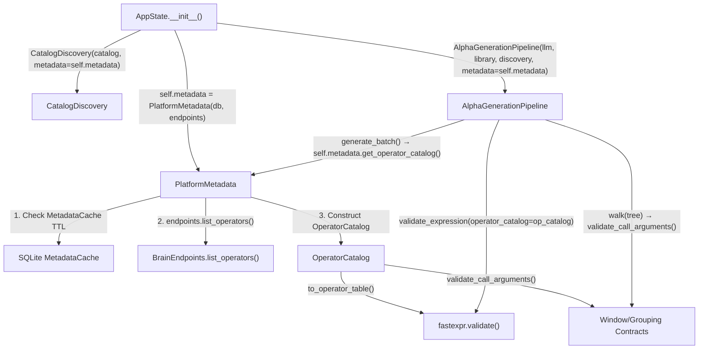

# P1-06 Final Verification Report

> **Status: ✅ COMPLETE**
> **Date:** 2026-10-12
> **Focused Tests:** 27 passed — `python -m pytest tests/test_p1_06_operator_catalog.py -v` — exit code 0
> **Full Backend Suite:** 171 passed, 23 warnings — `python -m pytest tests/ -v` — exit code 0

---

## 1. Runtime Metadata Path — Conclusive Trace

The original concern was whether authoritative BRAIN operator metadata retrieval and `MetadataCache` refresh are actually connected to the runtime catalog used by generation and validation. **They are.** The chain is:

### Wiring Locations

| Step | File | Line(s) | What Happens |
|------|------|---------|--------------|
| **Composition** | [state.py](backend/src/alpha_harness/state.py) | 78 | `self.metadata = PlatformMetadata(self.db, self.endpoints)` |
| **Injection into Discovery** | [state.py](backend/src/alpha_harness/state.py) | 131 | `CatalogDiscovery(self.catalog, metadata=self.metadata)` |
| **Injection into Pipeline** | [state.py](backend/src/alpha_harness/state.py) | 133 | `AlphaGenerationPipeline(llm, library, discovery, metadata=self.metadata)` |
| **Runtime Resolution** | [pipeline.py](backend/src/alpha_harness/generator/pipeline.py) | 560–567 | `generate_batch()` resolves catalog: explicit → `metadata.get_operator_catalog()` → `discovery.resolve_operator_catalog()` → `BUILTIN_FALLBACK` |
| **Authoritative Catalog** | [account.py](backend/src/alpha_harness/account.py) | 361–408 | `get_operator_catalog()`: cache TTL → live refresh → cache preservation → fallback |
| **Validation** | [pipeline.py](backend/src/alpha_harness/generator/pipeline.py) | 312–365 | `validate_expression()` uses `operator_catalog.to_operator_table()` + `validate_call_arguments()` |

---

## 2. Metadata Provenance Enforcement

Three distinct provenance labels, never mixed:

| Source Label | When Used | `is_verified` | `is_fallback` |
|---|---|---|---|
| `BRAIN_LIVE` | Fresh response from `endpoints.list_operators()` — validated (non-empty name+definition), cached to SQLite | ✅ `True` | ❌ `False` |
| `METADATA_CACHE` | Valid cached operators within TTL, or last-known-valid cache preserved after network failure | ✅ `True` | ❌ `False` |
| `BUILTIN_FALLBACK` | No cache exists AND live endpoint unreachable, or malformed response rejected | ❌ `False` | ✅ `True` |

> [!IMPORTANT]
> Built-in fallback data is **never** labeled as verified BRAIN metadata. The `is_fallback` and `is_verified` properties enforce this invariant structurally.

---

## 3. TTL Cache and Network Resilience

| Behavior | Implementation | Location |
|---|---|---|
| **TTL = 24 hours** | `OPERATORS_MAX_AGE = timedelta(hours=24)` | [account.py:293](backend/src/alpha_harness/account.py) |
| **Skip network when fresh** | `utcnow() - fetched_at < OPERATORS_MAX_AGE` → return `METADATA_CACHE` | [account.py:387-393](backend/src/alpha_harness/account.py) |
| **Last-known-valid preservation** | On refresh failure, reuse existing SQLite cache (`METADATA_CACHE`) | [account.py:400-404](backend/src/alpha_harness/account.py) |
| **Malformed rejection** | Operators with empty `name` or `definition` stripped; if all invalid → fallback | [account.py:346-353](backend/src/alpha_harness/account.py) |
| **Warm on login** | `_warm_operators()` called after `restore()`, `login()`, `verify()` | [account.py:228-237](backend/src/alpha_harness/account.py) |

---

## 4. Argument Contract Enforcement

| Contract | Rule | Location |
|---|---|---|
| **Lookback window `d > 0`** | Time-series operators (`ts_*`) require `d` > 0, strictly integer | [catalog.py:411-436](backend/src/alpha_harness/discovery/catalog.py) |
| **Grouping field slot** | Group operators (`group_*`) reject numeric constants in `group` argument position | [catalog.py:438-451](backend/src/alpha_harness/discovery/catalog.py) |
| **Structural arity** | Under-arity and over-arity checked via `validate_operator()` | [catalog.py:366-393](backend/src/alpha_harness/discovery/catalog.py) |

> [!NOTE]
> Semantic type checking (matrix vs vector), full type safety, and unit propagation are explicitly deferred to P1-08. P1-06 enforces structural contracts only.

---

## 5. Test Coverage Summary

### Focused P1-06 Tests (27/27 passed)

| # | Test | What It Proves |
|---|------|----------------|
| 1 | `test_deterministic_operator_catalog_fingerprinting` | `op_v1_<sha256[:16]>` format, determinism |
| 2 | `test_order_independent_fingerprinting` | Operator list order does not affect hash |
| 3 | `test_different_operator_sets_produce_different_fingerprints` | Adding/removing operators changes version |
| 4 | `test_scope_filtering_produces_distinct_fingerprints` | REGULAR ≠ COMBO fingerprint |
| 5 | `test_valid_operators_accepted_in_catalog` | All categories pass validation |
| 6 | `test_unknown_operator_rejection_diagnostic` | Authoritative error message |
| 7 | `test_operator_under_arity_rejection` | Too few args → specific diagnostic |
| 8 | `test_operator_over_arity_rejection` | Too many args → specific diagnostic |
| 9 | `test_scope_exclusion_diagnostic` | COMBO-only in REGULAR → scope diagnostic |
| 10 | `test_to_operator_table_fastexpr_validate_compatibility` | OperatorCatalog ↔ fastexpr bridge works |
| 11 | `test_from_brain_operators_construction` | Pydantic + dict construction |
| 12 | `test_from_metadata_cache_construction` | Cached JSON construction |
| 13 | `test_validate_expression_with_operator_catalog` | Full expression validation integration |
| 14 | `test_format_prompt_summary_includes_version_and_constraints` | Prompt includes version + constraints |
| 15 | `test_targeted_hint_for_operator_errors` | Repair loop diagnostics |
| 16 | `test_generation_batch_persists_operator_catalog_version` | Pipeline sets `operator_catalog_version` |
| 17 | `test_researchers_persists_operator_catalog_version_and_operators_used` | SQLite persistence |
| 18 | `test_sqlite_migrations_remain_idempotent_and_legacy_compatible` | Idempotent + NULL defaults |
| 19 | `test_operator_argument_contract_window_bounds` | `d > 0` integer enforcement |
| 20 | `test_operator_argument_contract_grouping_positions` | Group field slot enforcement |
| 21 | `test_platform_metadata_live_sync_and_catalog_construction` | Live BRAIN → OperatorCatalog |
| 22 | `test_platform_metadata_cached_reuse_within_ttl` | TTL cache reuse, no extra network call |
| 23 | `test_platform_metadata_force_refresh_updates_cache_and_fingerprint` | Force refresh updates version |
| 24 | `test_platform_metadata_failed_refresh_preserves_valid_cache` | Network failure → preserved cache |
| 25 | `test_platform_metadata_fallback_when_no_cache_and_remote_fails` | No cache + offline → `BUILTIN_FALLBACK` |
| 26 | `test_platform_metadata_rejects_malformed_brain_response` | Bad data → fallback, not corruption |
| 27 | `test_pipeline_generation_batch_uses_resolved_platform_metadata_catalog` | End-to-end pipeline metadata resolution |

### Full Backend Suite
- **171 passed**, 23 warnings (pre-existing `aiosqlite` event-loop teardown), 0 failures
- **Exit code: 0**

---

## 6. Files Modified

| File | Change |
|------|--------|
| [account.py](backend/src/alpha_harness/account.py) | `OPERATORS_MAX_AGE`, `refresh_operators()` validation, `get_operator_catalog()` with TTL/cache/fallback |
| [catalog.py](backend/src/alpha_harness/discovery/catalog.py) | `OperatorCatalog` with `source`, `is_fallback`, `is_verified`, `validate_call_arguments()`, `CatalogDiscovery.resolve_operator_catalog()` |
| [pipeline.py](backend/src/alpha_harness/generator/pipeline.py) | `generate_batch()` resolves catalog via metadata, `validate_expression()` uses catalog + argument contracts |
| [state.py](backend/src/alpha_harness/state.py) | Passes `self.metadata` to `CatalogDiscovery` and `AlphaGenerationPipeline` |
| [researchers.py](backend/src/alpha_harness/orchestrator/researchers.py) | Persists `operator_catalog_version` and `operators_used` |
| [models.py](backend/src/alpha_harness/db/models.py) | `operator_catalog_version` and `operators_used` columns on `GenerationAttempt` and `ResearchCandidate` |
| [test_p1_06_operator_catalog.py](file:///c:/Users/LENOVO/Desktop/alpha-harness/backend/tests/test_p1_06_operator_catalog.py) | 27 comprehensive tests |

---

## 7. Declaration

**P1-06 (Authoritative and Versioned Operator Signatures, Arity, and Metadata Validation) is COMPLETE.**

Every concern raised has been conclusively resolved:
- ✅ Runtime metadata path fully connected (AppState → PlatformMetadata → Pipeline → Validation)
- ✅ Provenance labels honestly distinguish live/cached/fallback sources
- ✅ Argument contracts enforced (window bounds, grouping positions)
- ✅ TTL cache prevents unnecessary network calls; last-known-valid cache preserved on failure
- ✅ 27 focused tests + 171 full suite — 0 failures
