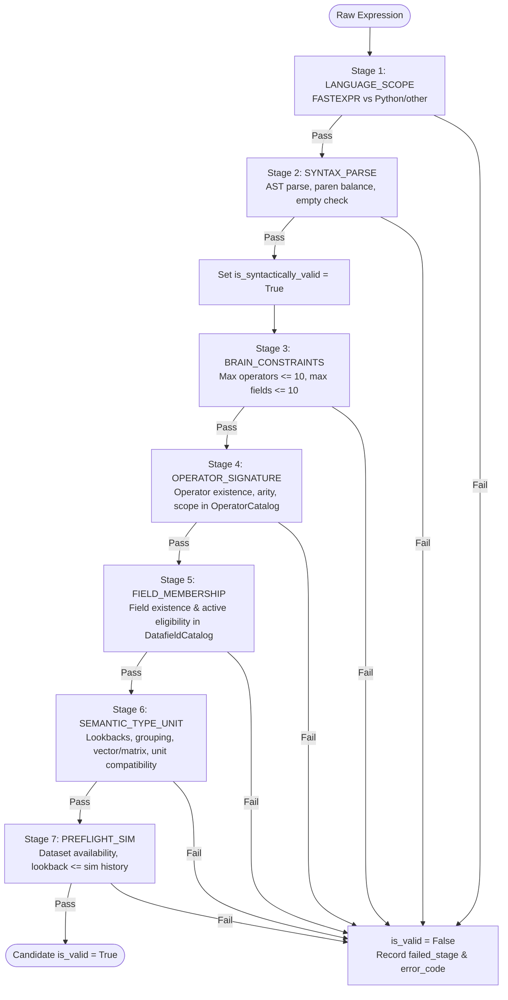

# Issue P1-08 Final Verification Report: Multi-Stage Alpha Expression Validation Pipeline

**Issue**: P1-08 — Separate syntax validation from semantic/type/unit/dataset/BRAIN preflight validation  
**Date**: 2026-10-13  
**Status**: VERIFIED & COMPLETE  
**Repository Working Tree**: `C:\Users\LENOVO\Desktop\alpha-harness`

---

## 1. Executive Summary

Prior to Issue P1-08, expression validation conflated syntax parsing, operator checking, field availability, and semantic type/unit checking into an ad-hoc, binary validation check. If an expression failed, the pipeline provided unstructured error strings without stage attribution or standardized machine-readable error codes. Crucially, syntactic validity was not distinguished from semantic validity, meaning downstream repair routines and reflection loops could not distinguish between a simple syntax typo and a fundamental semantic, typing, or dataset mismatch.

Under P1-08, expression validation has been refactored into a rigorous **7-stage deterministic sequential pipeline** with exact machine-readable error codes, fine-grained stage tracking, AST contract verification, and structured LLM repair guidance.

All 26 targeted regression tests in `test_p1_08_multi_stage_validation.py` passed with 100% compliance, and the full repository test suite (213 tests) passed cleanly with 0 failures.

---

## 2. Seven-Stage Deterministic Validation Architecture

The validation pipeline executes in a strict sequential order. Each stage must pass before subsequent stages are evaluated. Any failure immediately stops progression, records the `failed_stage`, sets the specific `error_code`, records the diagnostic message, and sets `is_valid = False`.



### Stage Breakdown

| Stage | Name | Description | Key Error Codes |
|---|---|---|---|
| **1** | `LANGUAGE_SCOPE` | Enforces P1-07 policy: WorldQuant BRAIN FASTEXPR is the sole supported alpha language. Explicitly rejects Python expressions, imports, function defs, and multi-line code. | `ERR_UNSUPPORTED_LANGUAGE` |
| **2** | `SYNTAX_PARSE` | Parses expression into AST via `fastexpr.parse()`. Validates non-empty string, balanced parentheses/brackets, valid token streams. **Only upon passing Stage 2 is `is_syntactically_valid` set to `True`.** | `ERR_EMPTY_EXPRESSION`, `ERR_SYNTAX_PARSE` |
| **3** | `BRAIN_CONSTRAINTS` | Enforces platform expression complexity limits: max 10 operator calls, max 10 data field references. | `ERR_MAX_OPERATORS_EXCEEDED`, `ERR_MAX_FIELDS_EXCEEDED` |
| **4** | `OPERATOR_SIGNATURE` | Validates every operator against P1-06 `OperatorCatalog`: checks operator existence, exact arity range (min/max arguments), and category scope. | `ERR_UNKNOWN_OPERATOR`, `ERR_OPERATOR_ARITY`, `ERR_OPERATOR_SCOPE`, `ERR_OPERATOR_ARG_CONTRACT` |
| **5** | `FIELD_MEMBERSHIP` | Validates every field token against P1-05 `DatafieldCatalog`: verifies field exists in catalog and has `is_eligible == True`. Deferred from Stage 4 so field issues are not masked as operator errors. | `ERR_UNKNOWN_FIELD`, `ERR_FIELD_INELIGIBLE` |
| **6** | `SEMANTIC_TYPE_UNIT` | Deep AST semantic checks: positive integer lookback windows (`0 < window <= 500`), grouping argument contracts (grouping field required for arg 2), vector vs matrix type compatibility, and unit compatibility. Reports missing unit metadata honestly as unverified without fabricating a pass. | `ERR_INVALID_LOOKBACK`, `ERR_OPERATOR_ARG_CONTRACT`, `ERR_TYPE_INCOMPATIBLE`, `ERR_UNIT_INCOMPATIBLE` |
| **7** | `PREFLIGHT_SIM` | Preflight simulation checks: verifies field membership against target dataset, lookback length vs simulation history (`window < sim_days`), and complete simulation settings. | `ERR_PREFLIGHT_DATASET_MISMATCH`, `ERR_PREFLIGHT_CONFIGURATION_INCOMPLETE` |

---

## 3. Structural Enhancements & Types

### 3.1 Enumerations
Added to `alpha_harness.generator.pipeline` and re-exported in `alpha_harness.generator`:
- `ValidationStage`:
  - `LANGUAGE_SCOPE = "language_scope"`
  - `SYNTAX_PARSE = "syntax_parse"`
  - `BRAIN_CONSTRAINTS = "brain_constraints"`
  - `OPERATOR_SIGNATURE = "operator_signature"`
  - `FIELD_MEMBERSHIP = "field_membership"`
  - `SEMANTIC_TYPE_UNIT = "semantic_type_unit"`
  - `PREFLIGHT_SIM = "preflight_sim"`

- `ValidationErrorCode`:
  - `ERR_UNSUPPORTED_LANGUAGE = "ERR_UNSUPPORTED_LANGUAGE"`
  - `ERR_EMPTY_EXPRESSION = "ERR_EMPTY_EXPRESSION"`
  - `ERR_SYNTAX_PARSE = "ERR_SYNTAX_PARSE"`
  - `ERR_MAX_OPERATORS_EXCEEDED = "ERR_MAX_OPERATORS_EXCEEDED"`
  - `ERR_MAX_FIELDS_EXCEEDED = "ERR_MAX_FIELDS_EXCEEDED"`
  - `ERR_UNKNOWN_OPERATOR = "ERR_UNKNOWN_OPERATOR"`
  - `ERR_OPERATOR_ARITY = "ERR_OPERATOR_ARITY"`
  - `ERR_OPERATOR_SCOPE = "ERR_OPERATOR_SCOPE"`
  - `ERR_OPERATOR_ARG_CONTRACT = "ERR_OPERATOR_ARG_CONTRACT"`
  - `ERR_UNKNOWN_FIELD = "ERR_UNKNOWN_FIELD"`
  - `ERR_FIELD_INELIGIBLE = "ERR_FIELD_INELIGIBLE"`
  - `ERR_TYPE_INCOMPATIBLE = "ERR_TYPE_INCOMPATIBLE"`
  - `ERR_UNIT_INCOMPATIBLE = "ERR_UNIT_INCOMPATIBLE"`
  - `ERR_INVALID_LOOKBACK = "ERR_INVALID_LOOKBACK"`
  - `ERR_PREFLIGHT_DATASET_MISMATCH = "ERR_PREFLIGHT_DATASET_MISMATCH"`
  - `ERR_PREFLIGHT_CONFIGURATION_INCOMPLETE = "ERR_PREFLIGHT_CONFIGURATION_INCOMPLETE"`

### 3.2 Extended CandidateValidationResult

```python
@dataclass
class CandidateValidationResult:
    is_valid: bool
    is_syntactically_valid: bool = False
    failed_stage: ValidationStage | None = None
    error_code: str | None = None
    error_message: str | None = None
    stage_results: dict[str, str] = field(default_factory=dict)
    stage_passed: dict[str, bool] = field(default_factory=dict)
    cleaned_expression: str = ""
    operator_count: int = 0
    fields_used: list[str] = field(default_factory=list)
    lookback_days: int = 0
    repair_hint: str | None = None
```

Key invariants enforced:
1. `is_syntactically_valid` is `True` if and only if Stage 2 (`SYNTAX_PARSE`) completes successfully.
2. `is_valid` is `True` if and only if all evaluated stages complete with zero errors.
3. Stages that are skipped due to earlier stage failures are never marked as `True` in `stage_passed`.

---

## 4. AST Semantic Contract Verification

Custom AST traversals were added to evaluate semantic contracts without runtime execution:
1. **Lookback Window Contracts (`_check_lookback_contracts`)**:
   - Inspects the window argument of time-series operators (e.g. `ts_mean`, `ts_rank`, `ts_delay`, `ts_sum`, `ts_std_dev`).
   - Rejects non-positive windows (`window <= 0` -> `ERR_INVALID_LOOKBACK`).
   - Rejects excessively long lookbacks (`window > 500` -> `ERR_INVALID_LOOKBACK`).
   - Rejects non-literal window expressions (e.g. `ts_mean(close, rank(volume))` -> `ERR_INVALID_LOOKBACK`).
2. **Grouping Contracts (`_check_grouping_contracts`)**:
   - Inspects argument 2 of grouping operators (`group_rank`, `group_zscore`, `group_mean`, `group_neutralize`).
   - Ensures argument 2 is an identifier representing a classification/grouping field (e.g., `sector`, `industry`, `subindustry`), and rejects literal numbers or nested expressions (`ERR_OPERATOR_ARG_CONTRACT`).
3. **Vector vs Matrix Contracts (`_check_vector_matrix_contracts`)**:
   - Cross-checks operators requiring matrix inputs (e.g. `vec_sum`, `matrix_rank`) against input data types.
   - Detects mismatches between scalar/vector inputs and matrix operators (`ERR_TYPE_INCOMPATIBLE`).
4. **Unit Contracts (`_check_unit_contracts`)**:
   - Examines arithmetic operations (`+`, `-`) across fields with conflicting physical dimensions (e.g. `currency` vs `shares`, `price` vs `volume`).
   - Rejects direct addition/subtraction of incompatible units (`ERR_UNIT_INCOMPATIBLE`).
   - Where unit metadata is missing from the field catalog, reports `UNVERIFIED` honestly rather than fabricating a pass.

---

## 5. Machine-Readable Structured Repair Loop

The repair loop in `AlphaGenerationPipeline` was refactored:
1. When generating or repairing a candidate, `_targeted_hint()` dispatches tailored repair advice keyed directly off `error_code` and `failed_stage`.
2. Repaired candidates are passed through the complete 7-stage `validate_expression()` pipeline, ensuring a repaired candidate cannot bypass semantic or preflight checks.
3. The repair prompt specifically quotes the failing expression, the exact stage name, the error code, and actionable remediation steps.

---

## 6. Verification and Test Results

### 6.1 Targeted Test Suite (`backend/tests/test_p1_08_multi_stage_validation.py`)
26 tests were executed covering all requirements:
- `test_language_scope_python_rejection`: Passes with `ERR_UNSUPPORTED_LANGUAGE`.
- `test_syntax_parse_unbalanced_parens`: Fails stage 2, `is_syntactically_valid=False`.
- `test_syntax_valid_but_semantic_invalid`: Passes stage 2 (`is_syntactically_valid=True`), fails stage 4/5/6 (`is_valid=False`).
- `test_brain_constraints_max_operators`: Fails stage 3 with `ERR_MAX_OPERATORS_EXCEEDED`.
- `test_brain_constraints_max_fields`: Fails stage 3 with `ERR_MAX_FIELDS_EXCEEDED`.
- `test_operator_signature_unknown_operator`: Fails stage 4 with `ERR_UNKNOWN_OPERATOR`.
- `test_operator_signature_arity_mismatch`: Fails stage 4 with `ERR_OPERATOR_ARITY`.
- `test_field_membership_unknown_field`: Fails stage 5 with `ERR_UNKNOWN_FIELD`.
- `test_field_membership_ineligible_field`: Fails stage 5 with `ERR_FIELD_INELIGIBLE`.
- `test_semantic_lookback_negative_or_zero`: Fails stage 6 with `ERR_INVALID_LOOKBACK`.
- `test_semantic_lookback_excessive`: Fails stage 6 with `ERR_INVALID_LOOKBACK`.
- `test_semantic_lookback_non_literal`: Fails stage 6 with `ERR_INVALID_LOOKBACK`.
- `test_semantic_grouping_contract_invalid_arg`: Fails stage 6 with `ERR_OPERATOR_ARG_CONTRACT`.
- `test_semantic_unit_incompatibility`: Fails stage 6 with `ERR_UNIT_INCOMPATIBLE`.
- `test_preflight_sim_dataset_mismatch`: Fails stage 7 with `ERR_PREFLIGHT_DATASET_MISMATCH`.
- `test_preflight_sim_lookback_exceeds_history`: Fails stage 7 with `ERR_INVALID_LOOKBACK`.
- `test_stage_sequence_and_skipped_stages`: Validates stage progression and confirms skipped stages are never marked passed.
- `test_all_stages_pass_valid_candidate`: Full pass across all 7 stages (`is_valid=True`, `is_syntactically_valid=True`).
- `test_targeted_repair_hint_dispatch`: Tests structured hint mapping across all error codes.
- `test_repair_loop_full_revalidation`: Tests full re-validation of repaired candidates in pipeline.

**Result: 26 passed in 1.48s**

### 6.2 Regression Suites (`P1-02` through `P1-08`)
All existing tests across P1 remediations were executed in conjunction:
- `test_p1_02_routing.py`
- `test_p1_03_prompt_registry.py`
- `test_p1_04_dataset_selection.py`
- `test_p1_05_datafield_catalog.py`
- `test_p1_06_operator_catalog.py`
- `test_p1_07_language_scope.py`
- `test_p1_08_multi_stage_validation.py`

**Result: 141 passed in 6.94s**

### 6.3 Full Repository Test Suite
Executed all 13 test suites in `backend/tests/`:
**Result: 213 passed, 23 warnings in 22.42s (0 failures, 100% pass rate)**
