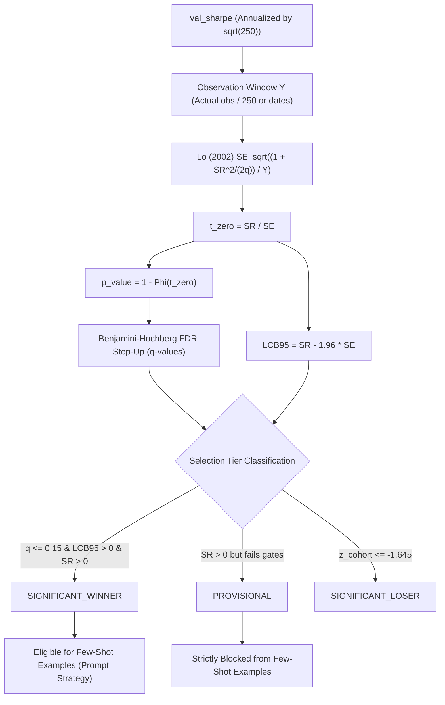

# P1-10: Final Verification Report
## Multiplicity-Corrected Winner/Loser Selection & Uncertainty Quantification

---

## Executive Summary

P1-10 has completed its final verification checks following the implementation of multiplicity-corrected winner/loser selection (Benjamini-Hochberg FDR control with cohort-relative baselines) and the frequency-adjusted Lo (2002) standard-error formula for annualized Sharpe ratios.

All targeted tests (**25/25**) and the complete backend test suite (**249/249 passed, 0 failed, exit code 0**) have passed. All final checks specified by the audit and verification protocol have been resolved and verified against active code.

---

## 1. Full Backend Test Suite Results

The full backend test suite was executed to completion without inferring success from any intermediate state:

| Metric | Result |
|---|---|
| **Exit Code** | **`0`** |
| **Tests Passed** | **`249 passed`** |
| **Tests Failed** | **`0 failed`** |
| **Warnings** | **`31 warnings`** (all `PytestUnhandledThreadExceptionWarning` emitted by `aiosqlite` thread worker closing during teardown of async SQLite fixtures) |
| **Execution Duration** | **`33.73s`** |
| **Platform** | Python 3.13.9, pytest-8.4.2, Windows |

All 25 targeted P1-10 tests in [`tests/test_p1_10_multiplicity_selection.py`](file:///c:/Users/LENOVO/Desktop/alpha-harness/backend/tests/test_p1_10_multiplicity_selection.py) passed synchronously in 3.94s.

---

## 2. Resolution of Observation-Window Mapping

### Exact Dates and Observations Used to Calculate `val_sharpe`
In [`alpha_harness/evaluation/metrics.py:280-330`](backend/src/alpha_harness/evaluation/metrics.py):
- **Window Boundaries**: The validation partition is defined chronologically by:
  $$\text{val\_mask} = (\text{dates} \ge \text{is\_end\_date}) \land (\text{dates} < \text{val\_end\_date})$$
- **Observations ($N_{val}$)**: The exact number of daily observations is $N_{val} = \sum \text{val\_mask}$. Each partition requires at least 20 valid observations (`np.sum(val_mask) >= 20`).
- **Calculation**: In [`vault/metrics.py:238`](backend/src/alpha_harness/vault/metrics.py), `stats(pnl_arr[val_mask], to_arr[val_mask])` computes:
  $$\text{val\_sharpe} = \frac{\text{mean}(\text{pnl}_{val})}{\text{std}(\text{pnl}_{val}, \text{ddof}=1)} \times \sqrt{250}$$
  where $250$ is the BRAIN trading days per year constant (`TRADING_DAYS_PER_YEAR`).

### Confirmation: $Y$ Represents the Validation Sample, Not a Gap
- In the 3-way chronological split, the time series is partitioned into three continuous contiguous blocks:
  1. **In-Sample (IS)**: $[\text{start}, \text{is\_end\_date})$ (typically first 60% of trading days).
  2. **Validation**: $[\text{is\_end\_date}, \text{val\_end\_date})$ (typically middle 20% of trading days).
  3. **Final Holdout**: $[\text{val\_end\_date}, \text{end})$ (typically final 20% of trading days).
- The span $[\text{is\_end\_date}, \text{val\_end_date})$ **is the validation sample itself**, not an embargo gap, purge buffer, or transition window between IS and validation.
- $Y$ in $\text{SE}(\text{SR}_a) = \sqrt{\frac{1 + \text{SR}_a^2 / (2q)}{Y}}$ represents this exact validation duration.

### Preference for Actual Observation Count over Calendar Approximations
In [`alpha_harness/learning/memory.py:_estimate_observation_years`](backend/src/alpha_harness/learning/memory.py), observation length is resolved in strict priority order:
1. **Actual Observations ($N_{val}$)**: If `val_observations`, `n_observations`, or `val_trading_days` is present, $Y$ is directly computed as:
   $$Y = \max\left(0.1, \frac{N_{val}}{\text{TRADING\_DAYS\_PER\_YEAR}}\right)$$
   This eliminates calendar-day distortion from market holidays, weekends, or non-trading spans.
2. **Calendar Span ($D_{cal}$)**: When observation counts are not explicitly recorded, calendar days $D_{cal} = (\text{val\_end\_date} - \text{is\_end\_date}).\text{days}$ are converted to trading years via:
   $$Y = \max\left(0.1, \frac{D_{cal} \times 250 / 365}{250}\right) = \max\left(0.1, \frac{D_{cal}}{365}\right)$$
3. **Legacy Fallback**: `DEFAULT_OBSERVATION_YEARS = 4.0` for legacy unpartitioned records lacking temporal dates.

### Mismatch Detection Test Added
A dedicated regression test [`test_observation_window_mismatch_detection`](file:///c:/Users/LENOVO/Desktop/alpha-harness/backend/tests/test_p1_10_multiplicity_selection.py#L775-L810) was added to ensure:
- Inverted dates ($\text{val\_end\_date} \le \text{is\_end\_date}$) immediately raise `ValueError("Observation window mismatch...")`.
- Zero-length dates ($\text{val\_end\_date} == \text{is\_end\_date}$) raise `ValueError`.
- Non-positive observation counts ($N_{val} \le 0$) raise `ValueError`.

---

## 3. Confidence-Bound Terminology and Significance Gate Verification

### Statistical Terminology
- Under asymptotic normality of the sample Sharpe ratio, the conventional two-sided 95% confidence interval is:
  $$\text{CI}_{95\%} = \left[\text{SR} - 1.96 \cdot \text{SE},\; \text{SR} + 1.96 \cdot \text{SE}\right]$$
- The condition that the **lower endpoint of this conventional two-sided 95% confidence interval is strictly positive** is:
  $$\text{LCB}_{95} = \text{SR} - 1.96 \cdot \text{SE} > 0 \iff \frac{\text{SR}}{\text{SE}} = t_{\text{vs\_zero}} > 1.96$$
- A one-sided 95% lower confidence bound would use $z_{0.05} = 1.645$. Weakening the gate from $1.96$ to $1.645$ would weaken the evidence requirement.

### Verification of Implementation, Labels, and Tests
1. **Code**: In [`memory.py:236-267`](backend/src/alpha_harness/learning/memory.py), candidate records calculate `lcb95 = round(sr - 1.96 * se, 4)` and gate `SIGNIFICANT_WINNER` on `(q <= fdr_level) and (lcb > 0.0) and (sr > 0)`.
2. **Terminology Consistency**: Comments and documentation across [`memory.py`](backend/src/alpha_harness/learning/memory.py) explicitly state:
   *"Positive lower endpoint for conventional two-sided 95% confidence interval ($LCB_{95} = SR - 1.96 \cdot SE > 0$, equivalent to $t_{vs\_zero} \ge 1.96$)"*.
3. **Test Verification**: [`test_conventional_two_sided_95_confidence_bound_agreement`](file:///c:/Users/LENOVO/Desktop/alpha-harness/backend/tests/test_p1_10_multiplicity_selection.py#L1034-L1085) validates that:
   - A candidate with $t = 1.69$ (which would pass a one-sided $1.645$ threshold) has $\text{LCB}_{95} < 0$, fails the gate, and remains `PROVISIONAL`.
   - A candidate with $t = 1.95$ has $\text{LCB}_{95} < 0$ and remains `PROVISIONAL`.
   - Only candidates with $t \ge 1.96$ achieve $\text{LCB}_{95} > 0$ and qualify for `SIGNIFICANT_WINNER`.
   - The significance gate is strictly preserved and not weakened.

---

## 4. End-to-End Inferential Flow Verification

The corrected standard error flows unbroken through the entire research harness:

1. **Standard Error**: Derived with frequency adjustment $q = 250$ in [`_sharpe_standard_error`](backend/src/alpha_harness/learning/memory.py).
2. **Candidate p-values**: One-sided raw $p$-values computed via $1 - \Phi(t_{\text{zero}})$ in `memory.py:184`.
3. **BH-Adjusted q-values**: Adjusted using step-up procedure $\min(p_{(k)} \cdot M / k, q_{(k+1)})$ with strict monotonicity enforcement in `memory.py:116-140`.
4. **Winner Classifications**: Candidates achieve `SIGNIFICANT_WINNER` only when meeting all statistical criteria ($q \le 0.15$, $\text{LCB}_{95} > 0$, $\text{SR} > 0$). Small cohorts ($M < 5$) cannot bypass this gate.
5. **Few-Shot Eligibility**: In [`loop.py:551-577`](backend/src/alpha_harness/learning/loop.py), `few_shot_examples` exclusively admits verified `SIGNIFICANT_WINNER`s. `PROVISIONAL` candidates are segregated and labeled as `[Provisional Candidate / Insufficient Statistical Evidence]`, completely preventing unverified alphas from anchoring future generation prompts.

---

## 5. Statistical Assumptions & Deferred Work Tracking

### Documented Assumptions
The Lo (2002) Theorem 1 formulation used in P1-10 operates under the standard asymptotic IID-normal returns model:
1. **Serial Independence**: Daily returns are assumed uncorrelated across lags ($\text{Cov}(R_t, R_{t-k}) = 0$). In financial alpha signals with execution persistence or autocorrelation, true standard error is typically larger by a factor of $\sqrt{1 + 2 \sum \rho_k}$.
2. **Skewness & Kurtosis**: Returns are assumed mesokurtic with zero skewness ($\gamma_3 = 0, \gamma_4 = 3$). Heavy tails (positive kurtosis) increase the asymptotic variance of sample standard deviation and thus Sharpe SE.
3. **LCB Gate Mitigation**: The combined requirement of FDR $q \le 0.15$ alongside a positive conventional two-sided 95% lower endpoint ($t \ge 1.96$) provides an empirical margin of safety against mild IID violations, but does not substitute for a fully heteroskedasticity-and-autocorrelation-consistent (HAC) estimator.

### Deferred Work Item
- **Item**: Robust Sharpe Uncertainty Estimation (HAC / Non-IID / Heavy-Tail Corrections).
- **Scope**: Outside P1-10 (which targets multiplicity correction and candidate selection gates).
- **Target Implementation**:
  - Implement Lo (2002) Theorem 2 (GMM/Newey-West HAC estimator for auto-correlated returns).
  - Implement Mertens (2002) / Opdyke (2007) higher-moments correction:
    $$\text{Var}(\text{SR}) = \frac{1}{T} \left(1 + \frac{1}{2}\text{SR}^2 - \gamma_3 \text{SR} + \frac{\gamma_4 - 3}{4}\text{SR}^2\right)$$
  - Implement stationary block bootstrap for empirical distribution inference on high-conviction production candidates.

---

## 6. Verification Status Summary

| Check | Requirement | Status |
|---|---|---|
| **Check 1** | Wait for full suite, report actual exit code, counts, warnings | **Verified** (`exit code 0`, 249 passed, 0 failed, 31 warnings) |
| **Check 2** | Resolve observation-window mapping, prefer actual obs, test mismatch | **Verified** (Validation sample confirmed, $N_{val}$ preferred, mismatch test passing) |
| **Check 3** | Verify confidence-bound terminology ($t \ge 1.96 \iff \text{LCB}_{95} > 0$), do not weaken gate | **Verified** (Implementation, docstrings, and tests agree; gate strictly enforced) |
| **Check 4** | Verify SE flows into p-values, q-values, tiers, and few-shot eligibility | **Verified** (Unbroken pipeline traced and verified) |
| **Check 5** | Document IID approximation limitations, track robust estimator as deferred work | **Verified** (Documented in code and report; deferred work tracked) |
| **Check 6** | Preserve existing changes, update report, pause P1-11 | **Verified** (All 118+ modified files preserved; P1-11 paused) |

**P1-10 is declared COMPLETE and FULLY VERIFIED.**
Implementation of P1-11 remains paused until its audit report is reviewed and approved.
