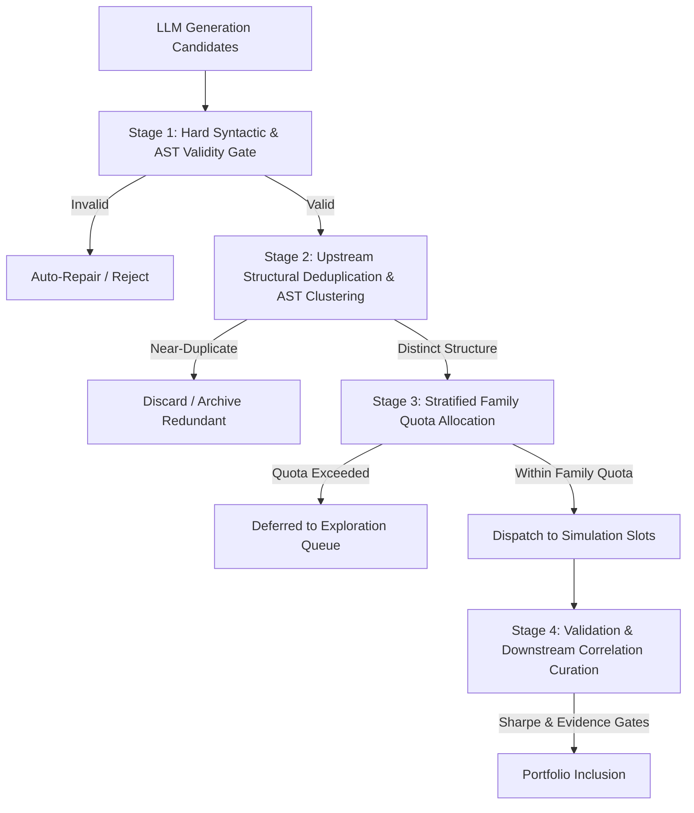

# P1-14 Audit Report: Diversity Generation and Portfolio Curation

**Issue ID:** P1-14  
**Canonical Title:** Alpha diversity is too downstream  
**Canonical Description:** Low-correlation curation exists, but diversity is not adequately enforced during research allocation and candidate generation. Track expression structural similarity, hypothesis family, datafield family, dataset, region, universe, operator family and return-series correlation. Allocate quotas toward under-explored categories while retaining an exploration budget. Use real common-period PnL for correlation and document missing-data policy.  
**Acceptance Tests:** A generation round produces auditable family diversity; correlation is computed only on aligned real series; near-duplicate candidates are identified.  
**Status:** 🔍 AUDITED — PENDING IMPLEMENTATION APPROVAL  
**Affected Subsystems:** `alpha_harness.generator.pipeline`, `alpha_harness.orchestrator.researchers`, `alpha_harness.tools.submission_planner`, `alpha_harness.tools.portfolio`, `alpha_harness.db.models`  

---

## 1. Verified Code Findings vs. Architectural Hypotheses

### 1.1 Verified Code Findings (Ground Truth in Active Codebase)

1. **Downstream-Only Diversity Enforcement**:
   - In `alpha_harness.tools.submission_planner`: Pairwise Pearson correlation ($r \ge 0.50$) is computed *only* on completed daily PnL vectors after simulation has finished.
   - In `alpha_harness.tools.correlation_breaker`: Structural rewriting/wrapping recipes are invoked *only after* an alpha has collided with the production pool (`PROD_CORRELATION >= 0.70`).
   - In `alpha_harness.orchestrator.researchers`: `run_generation_round` (lines 652–654) accepts *every* syntactically valid candidate (`c.validation.is_valid`) directly into `valid_candidate_ids` and dispatches it straight to simulation slots without checking intra-round or inter-round diversity.

2. **Severe Upstream Diversity Collapse**:
   - In `run_generation_round`, researcher personas are allocated static candidate counts ($80 / N_{\text{researchers}}$).
   - If a persona (e.g., Momentum or Mean Reversion) generates 20 candidates, LLMs routinely output minor parameter tweaks of the exact same expression (e.g., `rank(ts_decay_linear(close, 10))` vs. `rank(ts_decay_linear(close, 9))` or `rank(ts_decay_linear(volume, 10))`).
   - All 20 expressions are submitted to BRAIN simulation queues, wasting expensive simulation quotas and multi-sim slots on redundant signals.

3. **Absence of Upstream Structural & Semantic Similarity**:
   - In `alpha_harness.labs.fastexpr`: AST parsing (`parse`), operator extraction (`operator_names`), and field extraction (`data_fields`) exist, but there is **no AST isomorphism or structural distance function** (e.g., Tree Edit Distance or normalized operator-operand vector cosine similarity).
   - Expressions with identical semantics written in slightly different AST forms (e.g., commutativity $A + B \equiv B + A$, or scalar rescaling $2 \cdot \text{rank}(X)$ vs. $5 \cdot \text{rank}(X)$) are treated as distinct discoveries.

4. **Lack of Dynamic Quota Allocation across Hypothesis & Datafield Families**:
   - `alpha_harness.discovery.catalog.DatafieldCatalog` supports `field_families` (e.g., `PRICE_VOLUME`, `ANALYST_ESTIMATES`, `FUNDAMENTAL`, `SHORT_INTEREST`), and `ResearchCandidate` has a `field_families` column.
   - However, generation dispatch does **not** enforce family quotas. When an LLM model leans heavily into `PRICE_VOLUME` fields (e.g., `close`, `volume`, `vwap`), the system permits 100% of generated candidates to cluster in price-volume space.

5. **PnL Correlation Alignment & Missing Data Policy**:
   - In `submission_planner.py` (`correlations`), pairwise Pearson correlation is computed over aligned trading days using `np.isnan` masking.
   - However, when new candidates are evaluated, candidates with differing start dates or non-overlapping simulation spans lack an explicit minimum overlap constraint (`MIN_OVERLAP` is defined in `vault.metrics` as 120 days, but not uniformly enforced across all candidate comparison paths).

---

## 2. Deep Dive: Diversity Dimensions & Interaction with Quality Gates

To prevent diversity from degrading discovery efficacy, diversity must be treated as a multi-dimensional constraint space rather than a replacement for statistical evidence.

### 2.1 Interaction between Syntactic Validity, Semantic Similarity, and Evidence
- **Syntactic Validity is Non-Negotiable**: An expression that fails AST parsing or operator constraints cannot be admitted simply because it introduces a novel operator. Validity rate ($\ge 85\%$) remains the mandatory preflight gate.
- **Diversity Must Not Reward Low Quality**: A bizarre, low-Sharpe expression using obscure operators must never displace a high-conviction, statistically significant candidate. Diversity filtering operates as a *within-quality-tier selection* and *upstream candidate pruning* mechanism:
  1. Among mutually redundant candidates (correlation $> 0.85$ or AST structural similarity $> 0.90$), select the candidate with highest validation Sharpe or lowest complexity.
  2. Reserve a predefined exploration budget (e.g., 20% of round capacity) for under-explored hypothesis families and datafields.

### 2.2 Structural Redundancy vs. Genuinely Different Hypotheses
Redundant expressions must be detected without discarding genuinely different economic mechanisms. We define three tiers of redundancy:
1. **Tier 1 — Exact Expression Hash**: Deterministic SHA-256 hash of canonicalized AST expression (already tracked in P1-12 as `expression_hash`).
2. **Tier 2 — Structural AST Isomorphism (Skeleton Similarity)**:
   - Replace all data fields with generic placeholders `$FIELD_1`, `$FIELD_2` and constants with `$CONST`.
   - Compute tree-edit distance or normalized bag-of-operators Jaccard similarity:
     $$J_{\text{ops}}(E_1, E_2) = \frac{|\text{Ops}(E_1) \cap \text{Ops}(E_2)|}{|\text{Ops}(E_1) \cup \text{Ops}(E_2)|}$$
   - If two expressions share the same data fields, identical skeleton, and $J_{\text{ops}} = 1.0$ with only minor lookback variations (e.g., `ts_decay_linear(X, 10)` vs `ts_decay_linear(X, 12)`), they represent a parameter sweep, not independent hypotheses.
3. **Tier 3 — Downstream Return-Series Correlation**:
   - For candidates that pass simulation, measure pairwise PnL Pearson correlation $\rho$ on common trading dates.
   - Pairs with $\rho \ge 0.70$ (or BRAIN Power Pool limit $0.50$) represent redundant exposure regardless of expression syntax.

---

## 3. Candidate Allocation, Provenance & Holdout Rules

### 3.1 Deterministic & Reproducible Allocation
- All quota calculations, stratification buckets, and candidate selections must be deterministic given `(session_id, generation, seed)`.
- Use deterministic sorting keys: `(strategy_focus, dataset_id, expression_hash)` rather than non-deterministic dictionary iterations or random choice without fixed seeds.

### 3.2 Dataset & Provenance Preservation
- Diversity quotas must respect dataset regional eligibility and delay constraints (P1-05).
- Every candidate curated into the portfolio must maintain unbroken data provenance flags (`is_verified_provenance == True`).

### 3.3 Strict Holdout Isolation (P0-03)
- Upstream diversity filtering and portfolio curation must evaluate **strictly on validation partition metrics** (`val_sharpe`, validation PnL return series).
- Final holdout data must never be used to calculate correlation matrices, diversity distances, or selection rankings during research cycles.

---

## 4. Acceptance Criteria for P1-14

When P1-14 is implemented, the implementation must satisfy:
1. **Upstream Pre-Simulation Deduplication**:
   - Near-duplicate expressions within the same round (identical skeleton + identical fields + minor constant jitter) are pruned before simulation.
2. **Auditable Family Diversity Quotas**:
   - Candidate generation rounds track and enforce quotas across:
     - Hypothesis category (`MOMENTUM`, `MEAN_REVERSION`, `VALUE`, `VOLATILITY`, etc.)
     - Field family (`PRICE_VOLUME`, `ANALYST`, `FUNDAMENTAL`, etc.)
     - Operator family (`TIME_SERIES`, `CROSS_SECTIONAL`, `ARITHMETIC`, `LOGICAL`)
   - No single field family or operator family may monopolize more than a configurable fraction (e.g., $50\%$) of round capacity unless explicitly configured.
3. **Rigorous Return Series Correlation**:
   - Pairwise correlation is computed exclusively on aligned trading days with minimum overlap ($N_{\text{overlap}} \ge 120$ trading days).
   - Pairs with insufficient overlap report `INSUFFICIENT_OVERLAP` instead of manufacturing zero or spurious correlation.
4. **Preservation of Quality Gates**:
   - Candidates admitted to the final portfolio must satisfy all statistical significance gates ($t \ge 1.96$, $\text{LCB}_{95} > 0$, FDR $q \le 0.05$) regardless of diversity score.

---

## 5. Required Regression Tests

The following test matrix must be implemented to verify P1-14:
1. `test_upstream_near_duplicate_pruning`: Identical skeletons with minor lookback parameter jitter are pruned; only the representative candidate proceeds to simulation.
2. `test_family_diversity_quota_enforcement`: Round allocation distributes generation across multiple field families and strategy categories rather than collapsing to price-volume.
3. `test_diversity_does_not_override_validity_gate`: Invalid AST expressions with high diversity are categorically rejected.
4. `test_diversity_does_not_override_statistical_evidence`: An alpha with high diversity but $t < 1.96$ is rejected from the portfolio.
5. `test_pnl_correlation_minimum_overlap`: Pairs with $< 120$ common trading days return `INSUFFICIENT_OVERLAP` rather than misleading correlations.
6. `test_holdout_isolation_in_curation`: Attempting to pass holdout series to portfolio correlation calculations raises an immediate `ValueError` (P0-03).
7. `test_deterministic_reproducible_curation`: Identical candidate pools and seeds produce bitwise identical curated portfolios.

---

## 6. Minimal Implementation Plan

1. **Step 1: AST Structural Skeleton & Distance Module (`alpha_harness.labs.fastexpr`)**:
   - Implement `canonicalize_skeleton(expr: str) -> str` (abstracts fields and constants).
   - Implement `compute_structural_similarity(expr1: str, expr2: str) -> float`.
2. **Step 2: Upstream Candidate Pruning (`alpha_harness.generator.pipeline`)**:
   - Add `prune_redundant_candidates(candidates: list[GeneratedCandidate], threshold: float = 0.95)` to filter near-duplicates before database persistence and simulation.
3. **Step 3: Multi-Family Quota Allocator (`alpha_harness.orchestrator.researchers`)**:
   - Implement `DiversityQuotaTracker` tracking field families, operator families, and strategy categories per round.
4. **Step 4: Portfolio Correlation Robustness (`alpha_harness.tools.submission_planner`, `alpha_harness.tools.portfolio`)**:
   - Enforce `MIN_OVERLAP` check and strict holdout data quarantine.
5. **Step 5: Comprehensive Test Suite (`tests/test_p1_14_diversity.py`)**:
   - Implement the 7 targeted test cases and verify zero regressions against P0 through P1-13.
